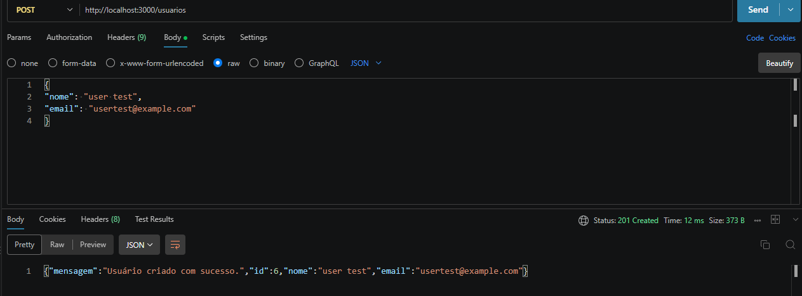
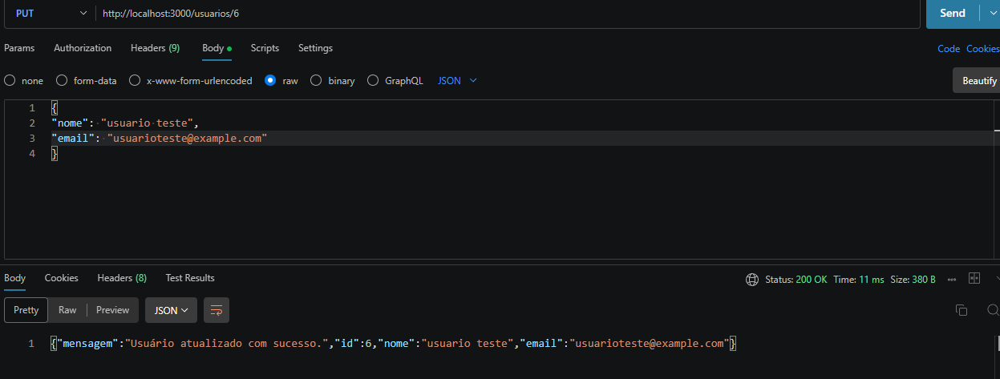
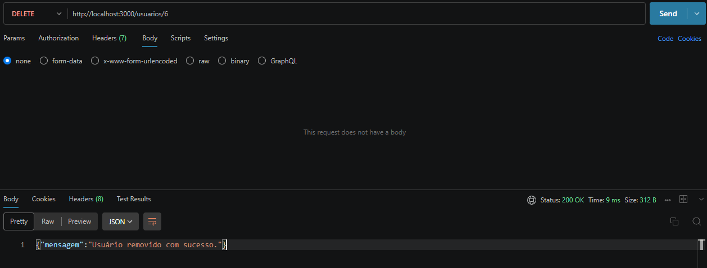
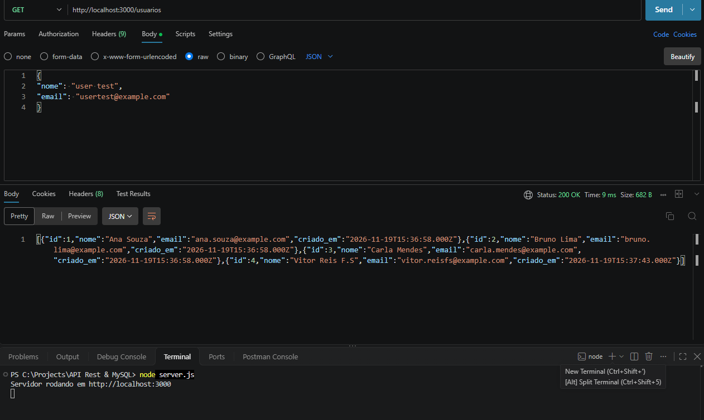

# API REST com Node.js e MySQL (sem ORM)

**Aluno:** SEU NOME COMPLETO
**Turma:** SUA TURMA
**Disciplina:** Programação Web III (PW3)

API REST com Express e MySQL, usando SQL direto via `mysql2` (Pool de conexões) com queries parametrizadas (`?`) para evitar SQL Injection.

## Tecnologias

- Node.js
- Express
- mysql2
- dotenv
- cors

## Pré-requisitos

- [Node.js](https://nodejs.org/) 18 ou superior
- [MySQL](https://dev.mysql.com/downloads/) 8 ou superior em execução

## Instalação e execução

1. Clone o repositório e entre na pasta:

   ```bash
   git clone https://github.com/SEU-USUARIO/nome-do-aluno-API-node-com-sql.git
   cd nome-do-aluno-API-node-com-sql
   ```

2. Instale as dependências:

   ```bash
   npm install
   ```

3. Crie o banco e a tabela executando o script `schema.sql`:

   ```bash
   mysql -u SEU_USUARIO -p < schema.sql
   ```

   (Ou abra o arquivo no MySQL Workbench e execute.)

4. Crie o arquivo `.env` a partir do modelo e preencha com suas credenciais:

   ```bash
   cp .env.example .env
   ```

5. Inicie o servidor:

   ```bash
   npm start
   ```

   A API ficará disponível em `http://localhost:3000`.

## Rotas

| Método | Rota            | Descrição                          | Retornos            |
|--------|-----------------|------------------------------------|---------------------|
| POST   | `/usuarios`     | Cria um usuário (`nome`, `email`)  | 201, 400, 409, 500  |
| GET    | `/usuarios`     | Lista todos os usuários            | 200, 500            |
| PUT    | `/usuarios/:id` | Atualiza `nome` e `email` por ID   | 200, 400, 404, 409, 500 |
| DELETE | `/usuarios/:id` | Remove o usuário pelo ID           | 200, 404, 500       |

### Exemplos

```bash
# Criar
curl -X POST http://localhost:3000/usuarios \
  -H "Content-Type: application/json" \
  -d '{"nome":"Daniel Rocha","email":"daniel@example.com"}'

# Listar
curl http://localhost:3000/usuarios

# Atualizar
curl -X PUT http://localhost:3000/usuarios/1 \
  -H "Content-Type: application/json" \
  -d '{"nome":"Ana Souza Silva","email":"ana.silva@example.com"}'

# Remover
curl -X DELETE http://localhost:3000/usuarios/1
```

## Estrutura

```
.
├── db.js            # Pool de conexões MySQL
├── server.js        # Servidor Express e rotas
├── schema.sql       # DDL + dados de exemplo
├── .env.example     # Modelo das variáveis de ambiente
├── .gitignore
├── package.json
└── README.md
```




